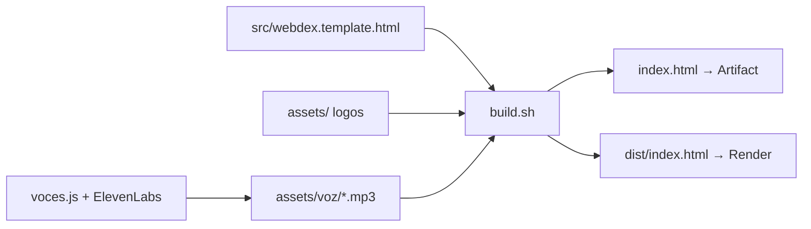
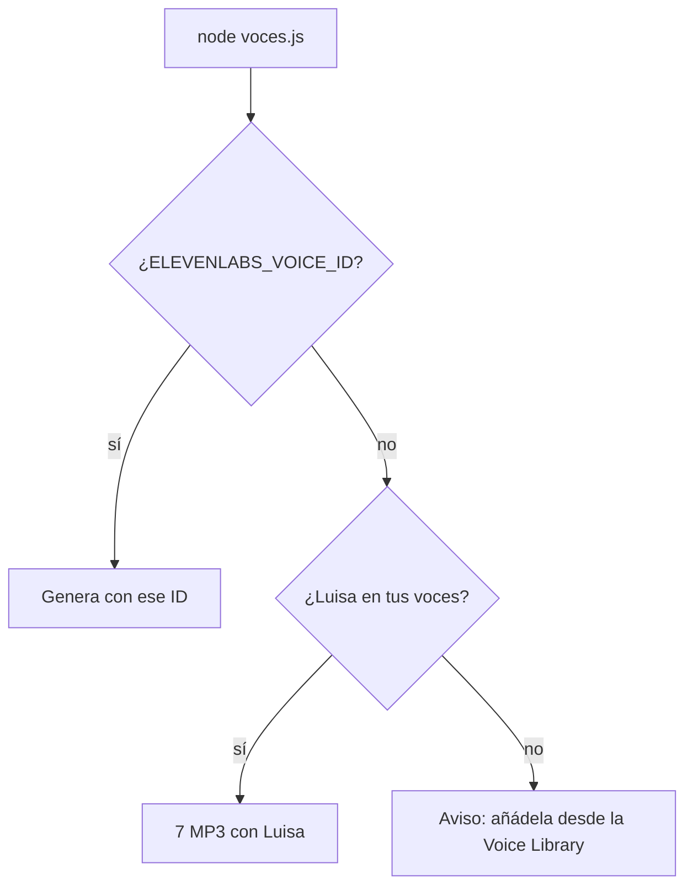

# WebDex

Una Pokédex que, en vez de Pokémon, cataloga **webs de juegos fan de Pokémon**.

| Pokédex clásica | WebDex |
|---|---|
| Sprite del Pokémon | Logo de la web |
| Nombre | Nombre de la web |
| Especie ("el Pokémon ratón") | Especie de la web ("la web rompecabezas") |
| Tipo (Fuego, Agua…) | Género del juego (Puzle, Roguelike, Survivor…) |
| Entrada de la Pokédex | De qué trata la web |
| Altura / Peso | Plataforma / Tipo de partida |
| — | Tarjeta de entrenador del creador, con avatar pixelado, título y medalla |
| Voz de la Pokédex del anime | Voz femenina de ElevenLabs (o la del navegador) que lee la entrada |
| Abrir la Pokédex | Animación de apertura al entrar: se enciende y la tapa se despliega |

## Entradas actuales

| Nº | Web | Especie | Géneros | Creador |
|---|---|---|---|---|
| 001 | [PokeDoku](https://pokedoku.com) | La web rompecabezas | Puzle · Trivia | DokuGames |
| 002 | [PokeRogue](https://pokerogue.net) | La web de las oleadas | Roguelike · Por turnos | Pagefault Games |
| 003 | [PokeSurvivor](https://pokesurvivor.com) | La web superviviente | Survivor · Acción | Entrenador desconocido |
| 004 | [PokéBonk](https://pokebonk.com) | La web de las hordas en 3D | Survivor · 3D | Entrenador desconocido |
| 005 | [PokeClash](https://www.playpokeclash.com) | La web de los duelos de cartas | Estrategia · Cartas (como Clash Royale) | Entrenador desconocido |
| 006 | [SurvivorTiers](https://survivortiers.pages.dev) | La web clasificadora | Guía · Survivor | Felipe Basurto |
| 007 | [PokéIsaac](https://pokeisaac.com) | La web de las mazmorras | Roguelike · Mazmorras · Cooperativo | Entrenador desconocido |

"Entrenador desconocido" significa que la web no indica quién la creó. SurvivorTiers es una guía, no un juego: su ficha tiene un botón **📘 Guía de: Nº003 PokeSurvivor** que salta a esa entrada.

### Colores de los géneros

| Género | Color (tipo Pokémon) |
|---|---|
| Puzle | Rosa (Psíquico) |
| Trivia | Amarillo (Eléctrico) |
| Roguelike | Rojo (Lucha) |
| Por turnos | Azul (Agua) |
| Survivor | Morado (Fantasma) |
| Acción | Naranja (Fuego) |
| 3D | Gris (Acero) |
| Estrategia | Violeta (Dragón) |
| Cartas | Rosa palo (Hada) |
| Guía | Turquesa (Hielo) |
| Mazmorras | Ocre (Tierra) |
| Cooperativo | Verde (Planta) |

## Cómo se usa

- Al entrar, la Pokédex **se abre sola** (unos 2 segundos). Un clic o una tecla la abre al instante.

- **◀ ▶** (cruceta) o las **flechas del teclado** para pasar de entrada.
- **Teclas azules**: saltar directamente a una entrada. Las grises (`???`) son huecos libres para webs futuras.
- **Buscador**: filtra por nombre, creador o género. **Chips de género**: filtra por tipo (pulsa otra vez para quitar el filtro).
- **🔊 HABLAR**: repite la voz. **🔇 SILENCIO**: apaga la voz y los pitidos.
- Enlace directo a una entrada: añade `#` y su nombre al final de la URL, por ejemplo `#pokebonk` o `#survivortiers`. También funciona si cambias el ancla con la página ya abierta.

## Archivos

```
index.html               ← la app ya construida (logos y voces incrustados), para el artefacto
dist/index.html          ← la misma app con <!doctype>: es lo que publica Render y se abre con doble clic
src/webdex.template.html ← código fuente con marcadores {{LOGO_...}} y {{VOICES}}
assets/                  ← logos originales de cada web
assets/voz/              ← MP3 de ElevenLabs, uno por entrada (los crea voces.js)
voces.js                 ← genera los MP3 con la API de ElevenLabs
build.sh                 ← genera index.html y dist/ a partir de src/ + assets/
serve.js                 ← servidor local: node serve.js → http://localhost:8765
```



## Cómo añadir una web nueva

1. Guarda su logo en `assets/` (p. ej. `assets/miweb.png`).
2. En `src/webdex.template.html`, añade un objeto al array `WEBS`:
   ```js
   {
     id: 8, slug: "miweb", nombre: "MiWeb", url: "https://miweb.com",
     logo: "{{LOGO_MIWEB}}", pixel: true,          // pixel: true para logos pixel art
     especie: "La web de…",                        // lo que dice la voz tras el nombre
     tipos: ["Puzle"],                              // deben existir en TYPES
     guiaDe: "pokesurvivor",                        // opcional: si es guía de otra entrada
     creador: "Nombre", rango: "Título creativo del entrenador",
     plataforma: "Navegador", partida: "Diaria",
     descripcion: "De qué trata la web…",
   },
   ```
3. Si usas un género nuevo, añádelo con su color en `TYPES`.
4. En `build.sh`, añade la línea `embed LOGO_MIWEB assets/miweb.png image/png`.
5. Genera su voz: `node voces.js miweb` (ver abajo).
6. Ejecuta `bash build.sh`.

## Cómo funciona la voz

Cada entrada lee, en este orden: nombre, especie, tipo, creador y descripción. Por ejemplo: *"PokeClash, la web de los duelos de cartas. Es de tipo Estrategia y Cartas, y no se sabe quién la creó. Un duelo de cartas…"*.

1. **Si existe `assets/voz/<slug>.mp3`** (generado con ElevenLabs), la página reproduce ese audio.
2. **Si no existe**, usa la voz del navegador (`speechSynthesis`): primero una voz femenina "natural" (en Edge, "Microsoft … Online (Natural)"; en Chrome, "Google español"), después cualquier voz femenina en español, con tono y ritmo normales.

Mientras habla, la lente azul parpadea. Los navegadores solo dejan sonar audio después de un clic, así que la voz empieza al primer cambio de entrada o al pulsar 🔊. **No es la voz original del anime**, que tiene derechos de autor.

### Generar las voces con ElevenLabs (`voces.js`)

**Voz elegida: "Luisa – Smooth, Friendly and Engaging"** (español latinoamericano, México). El script la busca **por nombre** entre tus voces de ElevenLabs, así que no hace falta copiar ningún ID.

Necesitas Node 18 o superior y una clave de API de ElevenLabs (en elevenlabs.io: tu perfil → *API Keys*). La clave **solo vive en la ventana de PowerShell** donde la pones: no se guarda en ningún archivo ni acaba dentro de la web.

1. **Añade a Luisa a tu cuenta** (solo la primera vez): elevenlabs.io → *Voces* → *Voice Library* → busca "Luisa" → **Añadir a mis voces**. La API solo puede usar voces que estén en tu cuenta.
2. Genera los audios y vuelve a construir la web:
   ```powershell
   cd "$HOME\Documents\WebDex"
   $env:ELEVENLABS_API_KEY = "tu-clave"
   node voces.js        # genera con Luisa los MP3 que faltan en assets/voz/
   bash build.sh        # los incrusta en la web
   ```

Si Luisa no está en tu cuenta, el script no gasta créditos: te dice que la añadas desde la Voice Library.

Otras opciones:
- `node voces.js --dry`: muestra los textos sin gastar créditos.
- `node voces.js --force`: regenera todos los MP3.
- `node voces.js pokeclash`: regenera solo esa entrada.
- `node voces.js --list`: lista tus voces con su ID.
- `$env:ELEVENLABS_VOICE_NAME = "Otra"` o `$env:ELEVENLABS_VOICE_ID = "id"`: usar otra voz (el ID tiene prioridad).



- Las 7 entradas suman unos **2.170 caracteres**, dentro del plan gratuito (10.000 al mes).
- Modelo `eleven_multilingual_v2` en español, con ajustes para una voz clara y cercana (`stability 0.45`, `similarity 0.8`, `style 0.25`).
- No se puede clonar la voz real del anime.
- Con el plan gratuito, el audio es para uso no comercial y hay que citar a ElevenLabs. El pie de la página ya lo hace.

El pitido al cambiar de entrada es una onda cuadrada de dos notas generada con WebAudio, sin archivos de sonido.

## Animación de apertura

Al cargar, la Pokédex aparece **cerrada**: la lente está apagada y la pantalla, oscura. Entonces:

1. Los LEDs parpadean y la lente se enciende.
2. La mitad derecha gira en 3D desde la bisagra. En móvil, la mitad de abajo se despliega hacia abajo.
3. La pantalla LCD se enciende con un parpadeo de tele antigua.

Todo dura unos 2,4 segundos y está en la función `boot()`, con las clases CSS `boot`, `dark` y `powering`. Se salta con un clic o una tecla, y no se reproduce si el sistema tiene activado "reducir movimiento".

## Publicación

- **Artefacto de Claude**: `index.html`.
- **Web pública en Render**: sitio estático conectado al repositorio de GitHub `Esclavotec/webdex`. Publica la carpeta `dist/` sin paso de compilación. Cada `git push` vuelve a desplegarla.

## Pruebas realizadas

| Prueba | Resultado |
|---|---|
| Las 7 fichas cargan con su logo, especie, tipos y creador | ✅ |
| ▶ recorre de 001 a 007 y vuelve a 001; la tecla ← retrocede | ✅ |
| Filtro Survivor → PokeSurvivor, PokéBonk y SurvivorTiers | ✅ |
| Filtro Guía → SurvivorTiers; filtro Estrategia → PokeClash | ✅ |
| Botón "Guía de" en 006 → salta a Nº003 PokeSurvivor | ✅ |
| Buscar "pagefault" → PokeRogue; buscar "zzz" → aviso de que no hay resultados | ✅ (v1) |
| Cargar con `#survivortiers` abre esa ficha; cambiar a `#pokeisaac` salta a PokéIsaac | ✅ |
| Voz elegida en Windows: Microsoft Helena (femenina, es-ES) | ✅ |
| La voz lee a bloques: nombre → especie → tipo → creador → descripción | ✅ |
| Con un creador desconocido dice "Creador desconocido." | ✅ |
| Con 🔇 activado no se lanza la voz | ✅ (v1) |
| Móvil 375px sin scroll horizontal; consola sin errores | ✅ |
| **v3**: la animación pasa por cerrada → apertura → pantalla encendida y queda usable | ✅ |
| **v3**: en móvil, la mitad de abajo se despliega sin scroll horizontal | ✅ |
| **v3**: la voz del navegador lee 3 frases fluidas | ✅ |
| **v3**: `node voces.js --dry` lista las 7 entradas (2.168 caracteres); sin clave avisa y sale | ✅ |
| **v3**: `build.sh` incrusta los MP3 de `assets/voz/` (probado con un audio de prueba) | ✅ |
| **v3**: con MP3, la ficha reproduce el audio y la lente parpadea; 🔇 lo corta; sin MP3 usa la voz del navegador | ✅ |

| **v3.1**: `voces.js` con un ElevenLabs simulado: sin clave avisa; sin Luisa en la cuenta explica cómo añadirla y no genera nada; con Luisa genera los 7 MP3 con su ID; al repetir no regenera | ✅ |

## Cambios

- **v3.1**: voz de ElevenLabs "Luisa – Smooth, Friendly and Engaging", buscada por nombre.

- **v3**
  - Animación de apertura de la Pokédex al entrar.
  - Voz más humana: voces naturales del navegador, tono normal y 3 frases fluidas.
  - Voces de ElevenLabs: `voces.js` genera un MP3 por entrada y `build.sh` los incrusta; si falta alguno, se usa la voz del navegador.
  - `dist/index.html` (antes `dist/WebDex.html`), listo para publicar en Render.

- **v2**
  - 4 webs nuevas: PokéBonk, PokeClash, SurvivorTiers y PokéIsaac.
  - 6 géneros nuevos: 3D, Estrategia, Cartas, Guía, Mazmorras y Cooperativo.
  - Campo **especie** en todas las fichas; se ve bajo el nombre y lo dice la voz.
  - Las guías enlazan a la ficha del juego (`guiaDe`).
  - Voz femenina robótica que lee a bloques, al estilo de la Pokédex del anime (antes era masculina y grave).
  - Arreglo: cambiar el `#ancla` con la página abierta ahora salta a esa ficha.
- **v1**: primera versión con PokeDoku, PokeRogue y PokeSurvivor.

---
Proyecto fan sin ánimo de lucro. Pokémon es marca de Nintendo, Creatures y GAME FREAK.
